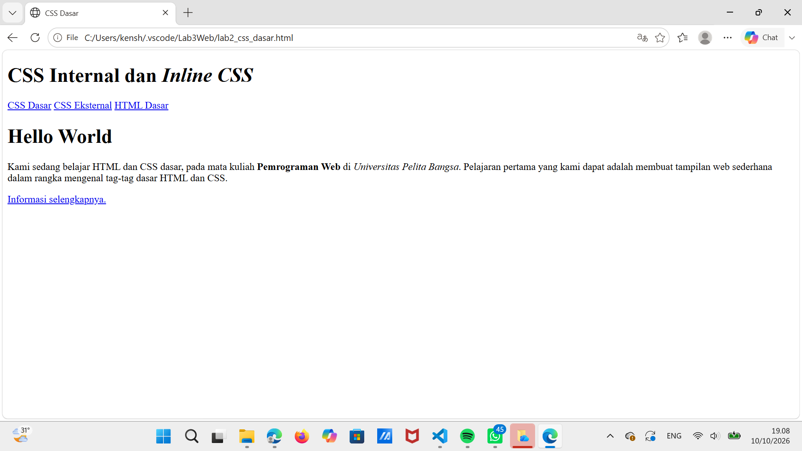
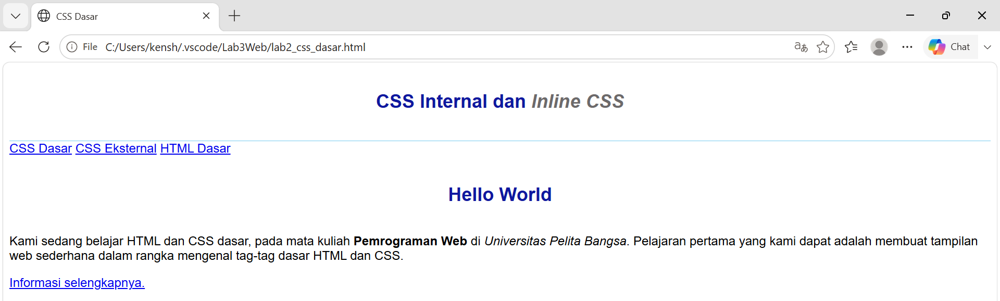
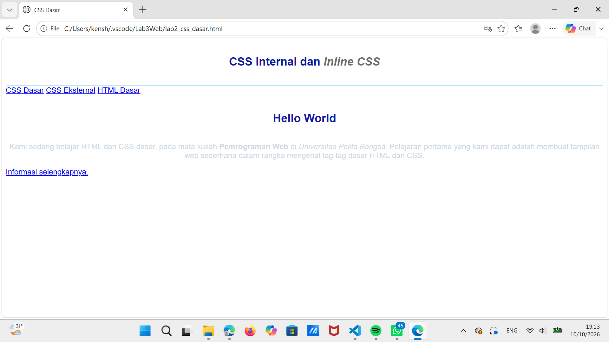
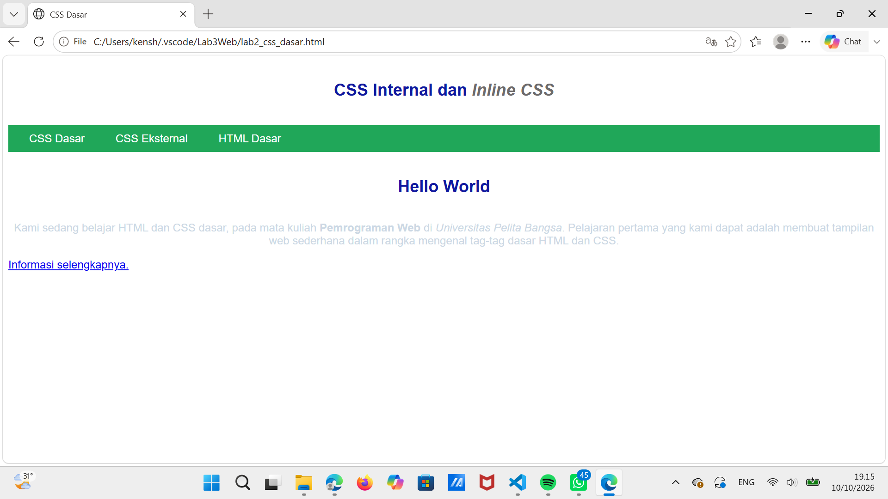
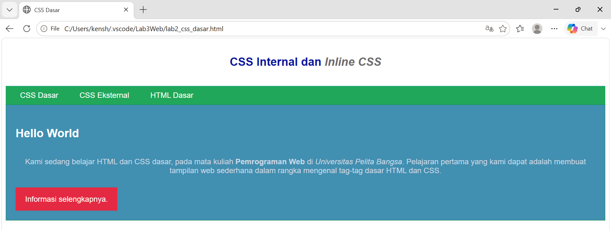
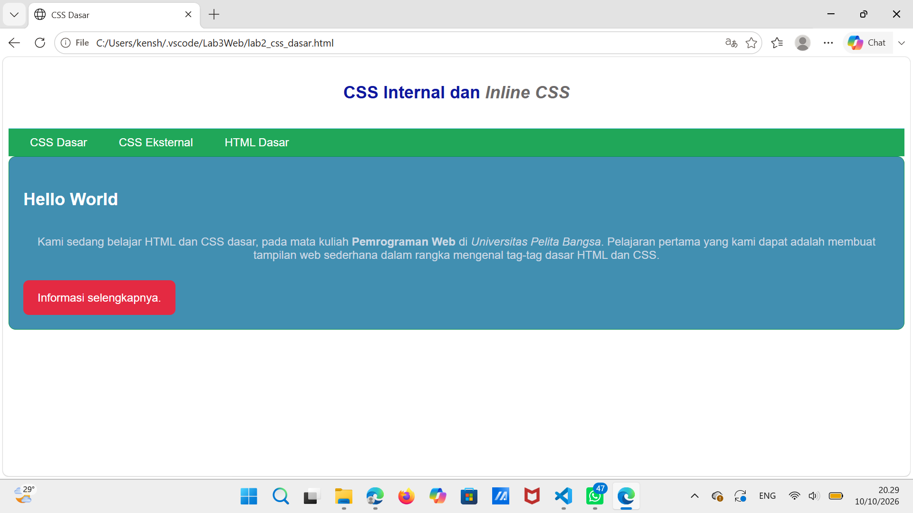
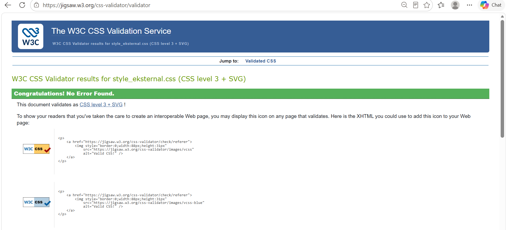

# Laporan Praktikum 3 — CSS Dasar

## Identitas Mahasiswa
- **Nama:** Kensha Dara Riafinola
- **Program Studi:** Teknik Informatika
- **Fakultas:** Teknik
- **Universitas:** Universitas Pelita Bangsa
- **Mata Kuliah:** Pemrograman Web

## 1. Tujuan Praktikum

1. Memahami konsep dasar CSS.
2. Memahami aturan penulisan CSS.
3. Memahami selector sebagai pengontrol CSS.
4. Membuat pengaturan CSS pada HTML.

## 2. Langkah-Langkah Praktikum

### Langkah 1 — Membuat Dokumen HTML

Membuat file `lab2_css_dasar.html` dengan struktur dasar HTML yang berisi header, navigasi, judul, paragraf, dan tautan informasi.



### Langkah 2 — Menambahkan CSS Internal

Menambahkan CSS Internal menggunakan tag `<style>` pada bagian `<head>`. CSS digunakan untuk mengatur jenis font, tinggi header, garis bawah header, ukuran judul, warna teks, dan perataan teks.



### Langkah 3 — Menambahkan Inline CSS

Menambahkan atribut `style` pada elemen paragraf untuk mengatur perataan teks menjadi rata tengah dan mengubah warna teks menjadi `#ccd8e4`.



### Langkah 4 — Membuat CSS Eksternal

Membuat file `style_eksternal.css` dan menghubungkannya dengan dokumen HTML menggunakan tag `<link>`. CSS eksternal digunakan untuk mengatur warna latar belakang navigasi, warna tautan, jarak, dan efek hover pada menu.



### Langkah 5 — Menambahkan ID dan Class Selector

Menambahkan ID selector `#intro` untuk mengatur tampilan kotak konten serta class selector `.button` dan `.btn-primary` untuk mengatur tampilan tombol Informasi selengkapnya.



### Eksperimen CSS — Mengubah Properti

Pada tahap ini dilakukan eksperimen dengan menambahkan properti `border-radius` pada selector `#intro` dan `.button`. Properti tersebut digunakan untuk membuat sudut kotak konten dan tombol menjadi membulat.



## 3. Validasi CSS

Melakukan validasi file `style_eksternal.css` menggunakan W3C CSS Validation Service melalui situs https://jigsaw.w3.org/css-validator/.

Hasil validasi menunjukkan pesan "Congratulations! No Error Found.", yang berarti tidak ditemukan kesalahan CSS oleh validator.




## Pertanyaan dan Tugas

### 1. Eksperimen CSS

Eksperimen dilakukan dengan menambahkan properti `border-radius`
pada selector `#intro` dan `.button` untuk membuat sudut kotak
konten dan tombol menjadi membulat.

### 2. Perbedaan Selector `h1` dan `#intro h1`

Selector `h1` digunakan untuk mengatur seluruh elemen heading
`<h1>` pada halaman HTML.

Sementara itu, selector `#intro h1` hanya digunakan untuk
mengatur elemen `<h1>` yang berada di dalam elemen dengan
ID `intro`.

Dengan demikian, selector `#intro h1` memiliki cakupan
yang lebih spesifik daripada selector `h1`.


### 3. Prioritas CSS Internal, Eksternal, dan Inline

Apabila CSS Internal, CSS Eksternal, dan Inline CSS mengatur
properti yang sama pada elemen yang sama, Inline CSS umumnya
memiliki prioritas lebih tinggi daripada deklarasi CSS Internal
dan Eksternal biasa.

Contoh:

CSS Internal atau Eksternal:
```css
p {
    color: blue;
}
```

Inline CSS pada HTML:
```html
<p style="color: red;">Belajar CSS</p>
```

Hasilnya, tulisan "Belajar CSS" berwarna merah karena properti
`color: red` ditulis secara Inline pada elemen tersebut.

Namun, prioritas CSS juga dapat dipengaruhi oleh penggunaan
`!important`, spesifisitas selector, dan urutan deklarasi.


### 4. Prioritas ID Selector dan Class Selector

Apabila sebuah elemen HTML memiliki atribut ID dan Class, kemudian kedua selector tersebut mengatur properti CSS yang sama, maka ID Selector memiliki prioritas lebih tinggi daripada Class Selector.

**Contoh HTML:**

```html
<p id="paragraf-1" class="text-paragraf">
    Ini adalah contoh paragraf.
</p>
```

**Contoh CSS:**

```css
#paragraf-1 {
    color: red;
}

.text-paragraf {
    color: blue;
}
```

**Penjelasan:**

Hasilnya, teks paragraf akan berwarna merah karena selector ID `#paragraf-1` memiliki spesifisitas lebih tinggi daripada selector Class `.text-paragraf`.

Dengan demikian, apabila kedua selector mengatur properti yang sama dan tidak ada aturan lain yang mengubah prioritasnya, deklarasi dari ID Selector yang akan diterapkan oleh browser.


## 4. Kesimpulan

Berdasarkan praktikum yang telah dilakukan, CSS dapat digunakan untuk mengatur tampilan halaman web. CSS dapat ditulis secara Internal, Inline, dan Eksternal. Selain itu, ID selector dan Class selector dapat digunakan untuk mengatur elemen HTML secara lebih spesifik.

Validasi CSS dilakukan untuk memeriksa kesesuaian penulisan kode CSS dengan aturan yang berlaku.
